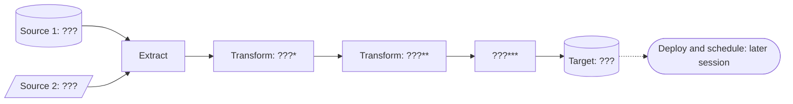
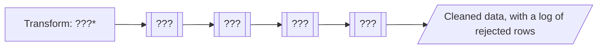
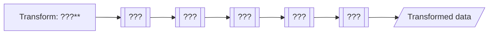
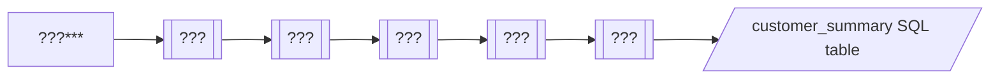

# 

## Activity 3: Design the Pipeline

**In session:** Activity 3.1 only (7 minutes, individually or in pairs)  
**After the session:** Activities 3.2 to 3.4 (extension)

### Before you start

1. In JupyterLab, double-click `etl-activity-3.md` to open it in the editor.
2. Right-click the file in the file browser and choose **Open With → Markdown Preview** to see the flowcharts. Place the preview beside the editor. JupyterLab draws Mermaid diagrams without any extension, and they also render on GitHub.
3. In the editor, replace every `???` with the correct label, keeping the quotation marks, then check the preview. If a diagram disappears, undo your last change: a missing quotation mark or bracket usually breaks it.

> **Remember:** an ETL pipeline has three stages. **Cleaning is the first part of Transform**, so Transform appears twice below: once to clean, once to combine and enrich.

---

### Activity 3.1: The high-level pipeline

Replace each `???` with the correct data source, stage or target. The asterisks link each box to its subprocess diagram in 3.2 to 3.4.

Check: does every requirement from Activity 1 have a home in this diagram?

---

### Activity 3.2: Transform, part 1 subprocesses*

Put the four cleaning steps in the right order. Think about which step must come **before** removing duplicates.

---

### Activity 3.3: Transform, part 2 subprocesses**

List the five steps that turn the two cleaned datasets into the `customer_summary` rows.

---

### Activity 3.4: Load subprocesses***

The client wants a **full refresh** that is safe to re-run and leaves the previous table intact if a run fails. List the steps.

